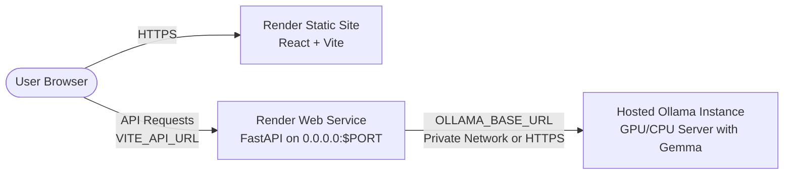

# 🕯️ Memory Lantern — A Private AI Remembrance Garden

> *"Some memories never fade. They simply find another way to shine."*

[](https://hacktoberfest.com/)
[](https://dev.to/)
[-38BDF8?style=for-the-badge&logo=google&logoColor=white)](https://ai.google.dev/gemma)
[](./LICENSE)

**Memory Lantern** is an emotional, elegant, and completely private digital remembrance garden designed for **Hacktoberfest 2026 (Week 4: Ghost in the Machine)**. Blending the warmth of *Día de los Muertos* ofrenda traditions with open-source artificial intelligence, it provides a quiet sanctuary to preserve cherished memories of loved ones, mentors, and pets, and illuminate those memories into heartfelt tribute letters using a locally running **Google Gemma** model.

---

## 📖 Table of Contents
- [1. Hacktoberfest 2026 Challenge Details](#1-hacktoberfest-2026-challenge-details)
- [2. Problem Statement](#2-problem-statement)
- [3. Project Features](#3-project-features)
- [4. Technology Stack](#4-technology-stack)
- [5. Architecture Overview](#5-architecture-overview)
- [6. Screenshots & Visual Previews](#6-screenshots--visual-previews)
- [7. Installation & Quickstart](#7-installation--quickstart)
  - [Prerequisites](#prerequisites)
  - [1. Ollama & Gemma Setup](#1-ollama--gemma-setup)
  - [2. Backend Setup (FastAPI)](#2-backend-setup-fastapi)
  - [3. Frontend Setup (React + Vite)](#3-frontend-setup-react--vite)
- [8. Running the Complete Application Locally](#8-running-the-complete-application-locally)
- [9. Production Deployment Guide (Render)](#9-production-deployment-guide-render)
  - [Architecture on Render](#architecture-on-render)
  - [Connecting Hosted Backend to a Hosted Ollama Instance](#connecting-hosted-backend-to-a-hosted-ollama-instance)
  - [Option A: Automated Blueprint Deployment (render.yaml)](#option-a-automated-blueprint-deployment-renderyaml)
  - [Option B: Manual Service Setup on Render](#option-b-manual-service-setup-on-render)
- [10. API Endpoints](#10-api-endpoints)
- [11. Why Open-Source AI Matters](#11-why-open-source-ai-matters)
- [12. Privacy & Security Considerations](#12-privacy--security-considerations)
- [13. Future Improvements](#13-future-improvements)
- [14. License](#14-license)

---

## 1. Hacktoberfest 2026 Challenge Details

- **Event:** Hacktoberfest 2026 Open-Source AI Challenge
- **Timeline:** Week 4 (October 2026)
- **Theme:** **Ghost in the Machine**
- **Theme Connection:** Re-interpreting Gilbert Ryle's philosophical paradox—how computing machinery can transcend cold calculation to become a compassionate, dignified vessel for human memory and love. Drawing on the cultural heritage of Halloween and *Día de los Muertos*, Memory Lantern turns binary circuits into glowing candlelight where memories remain alive.

---

## 2. Problem Statement

Modern digital memorials are frequently plagued by two deep flaws:
1. **Commercial Exploitation & Surveillance Cloud APIs:** Traditional platforms monetize grief, subject users to advertising banners, or feed private family memories into proprietary cloud LLMs to train third-party models.
2. **Cold, Impersonal Reductionism:** Digital archives often reduce rich human lives to sterile birth and death dates, neglecting the sensory textures—a grandmother's spiced hot chocolate, a father's favorite jazz record, or the distinct laughter that filled Sunday mornings.

**Memory Lantern solves this** by pairing 100% in-browser client-side storage (`LocalStorage`) with fully offline, local open-weight AI inference via **Google Gemma** and **Ollama**.

---

## 3. Project Features

- 🌿 **The Memory Garden:** A visual gallery of planted memories featuring search, relationship filtering, lit-candle indicators, detailed memory inspection modals, and full CRUD operations.
- 🕯️ **Virtual Ofrenda Altar:** A *Día de los Muertos* inspired remembrance space adorned with marigolds (*cempasúchil*), golden candlelight glows, realistic flickering animations, and interactive candle-lighting that persists locally.
- ✨ **AI Tribute Generator:** Powered by local Google Gemma via FastAPI, transforming sensory details into four formats:
  - **Heartfelt Remembrance Letter**
  - **Eulogy / Tribute Speech**
  - **Memory Quotes Collection**
  - **Ofrenda Blessing Message**
  - Selectable writing styles: *Heartfelt*, *Poetic*, *Simple and Personal*, *Nostalgic*.
- 🔒 **Zero Cloud Leakage:** All memories remain stored in browser `LocalStorage`. The AI connects only to your local Ollama port (`http://localhost:11434`).
- 🎵 **Acoustic Ambience:** Pure Web Audio API synthesized peaceful wind chimes and harmonic chords on candle illumination without external audio dependencies.
- 🚦 **Real-Time Model Status Badge:** Detects backend health and installed Ollama models with one-click switching and dynamic terminal setup guides.

---

## 4. Technology Stack

### Frontend
- **Framework:** React 19, Vite
- **Styling:** Tailwind CSS v4, Vanilla CSS keyframe animations
- **Routing:** React Router v7
- **Icons:** Lucide React
- **Celebration Effects:** Canvas Confetti

### Backend
- **Framework:** Python 3.10+, FastAPI
- **Data Validation:** Pydantic v2
- **Networking:** HTTPX (async client)
- **Server:** Uvicorn ASGI

### AI Engine
- **Model:** Google Gemma Open-Weights (`gemma2:2b` default, with configurable support for `gemma3:1b`)
- **Runtime:** Ollama Local Inference API (`/api/chat`)

### Storage
- **Persistence:** Client-side HTML5 LocalStorage (zero cloud database required)

---

## 5. Architecture Overview

```mermaid
graph TD
    User([User Browser]) <-->|React + Tailwind CSS| UI[Frontend UI / LocalStorage]
    UI <-->|REST API Proxy| API[FastAPI Backend - Port 8000]
    API <-->|Async HTTPX| Ollama[Ollama Local Runtime - Port 11434]
    Ollama <-->|Local Inference| Gemma[Google Gemma Open Weights]

    subgraph Privacy Perimeter (100% Local Machine)
        UI
        API
        Ollama
        Gemma
    end
```

---

## 6. Screenshots & Visual Previews

| The Memory Lantern Hero | The Virtual Ofrenda Altar |
| :---: | :---: |
| *(Hero section with golden lantern & theme)* | *(Interactive candles & marigold altar)* |

| The Memory Garden | Gemma AI Tribute Generator |
| :---: | :---: |
| *(Searchable memory cards & filters)* | *(Emotional letters & local model controls)* |

---

## 7. Installation & Quickstart

### Prerequisites
- [Node.js](https://nodejs.org/) (v18 or higher)
- [Python](https://www.python.org/) (v3.10 or higher)
- [Ollama](https://ollama.com/) installed and running locally

---

### 1. Ollama & Gemma Setup

1. Start the Ollama local daemon:
```bash
ollama serve
```

2. Pull the Gemma model:
```bash
ollama pull gemma2:2b
```
*(Or pull `gemma3:1b` if using 1B weights: `ollama pull gemma3:1b`)*

---

### 2. Backend Setup (FastAPI)

1. Navigate to the backend directory:
```bash
cd backend
```

2. Create and activate a Python virtual environment (optional but recommended):
```bash
# Windows
python -m venv venv
.\venv\Scripts\activate

# macOS / Linux
python3 -m venv venv
source venv/bin/activate
```

3. Install required Python dependencies:
```bash
pip install -r requirements.txt
```

4. Verify your environment variables (`backend/.env`):
```env
HOST=0.0.0.0
PORT=8000
OLLAMA_BASE_URL=http://localhost:11434
OLLAMA_MODEL=gemma2:2b
CORS_ORIGINS=http://localhost:5173,http://127.0.0.1:5173
```

5. Run unit tests to verify backend connectivity:
```bash
python test_api.py
```

6. Start the FastAPI server:
```bash
python -m uvicorn main:app --host 127.0.0.1 --port 8000 --reload
```

---

### 3. Frontend Setup (React + Vite)

1. Open a new terminal and navigate to the frontend directory:
```bash
cd frontend
```

2. Install dependencies:
```bash
npm install
```

3. Start the development server:
```bash
npm run dev
```

4. Open your browser and navigate to:
```
http://localhost:5173/
```

---

## 8. Running the Complete Application Locally

To run the full stack simultaneously on your local machine:

| Service | Command | URL |
| :--- | :--- | :--- |
| **Ollama Daemon** | `ollama serve` | `http://localhost:11434` |
| **FastAPI Backend** | `python -m uvicorn main:app --port 8000` | `http://127.0.0.1:8000` |
| **Vite Frontend** | `npm run dev` | `http://localhost:5173` |

---

## 9. Production Deployment Guide (Render)

Memory Lantern is designed to deploy cleanly to [Render](https://render.com/) using a two-service architecture:
1. **Frontend**: Render Static Site (React + Vite).
2. **Backend**: Render Web Service (FastAPI + Python).



### Architecture on Render

- **Frontend Static Site**: Serves compiled HTML, CSS, and JS from `./frontend/dist`.
- **SPA Routing Support**: The file [`frontend/public/_redirects`](./frontend/public/_redirects) (`/* /index.html 200`) is automatically included in the build output so that direct page refreshes on `/garden`, `/tribute`, `/ofrenda`, and `/about` resolve cleanly without 404 errors.
- **Dynamic API Target**: Configured via the `VITE_API_URL` environment variable. In local development it defaults to `/api` (using Vite proxy); in production it points directly to your deployed FastAPI backend URL.
- **Backend Web Service**: Listens on `0.0.0.0` and Render's dynamic `$PORT`.
- **CORS Support**: FastAPI automatically permits requests from `https://*.onrender.com` subdomains and any origins configured in `CORS_ORIGINS`.

---

### Connecting Hosted Backend to a Hosted Ollama Instance

> [!IMPORTANT]
> **Understanding "localhost" in Cloud Containers:**
> When your FastAPI backend runs on Render, `localhost` (or `127.0.0.1`) refers **strictly to the isolated Render container itself**, NOT to your personal development computer. Your local Ollama running on your laptop will not be accessible to Render unless exposed over the internet.

For production, connect your hosted backend to a hosted Ollama instance using one of the following methods:

#### Method 1: Self-Hosted Ollama on a Cloud VM or GPU Instance (Recommended for Gemma)
1. Deploy Ollama on a GPU/CPU server (e.g., RunPod, Modal, DigitalOcean, Hetzner, AWS EC2, or a private server).
2. Start Ollama with open host binding:
   ```bash
   OLLAMA_HOST=0.0.0.0:11434 ollama serve
   ```
3. Pull the model on that host:
   ```bash
   ollama pull gemma2:2b
   ```
4. Set the backend environment variable on Render:
   ```env
   OLLAMA_BASE_URL=https://your-ollama-instance.example.com
   ```

#### Method 2: Render Private Service with Docker
1. Create a Docker-based Private Service on Render using the official `ollama/ollama` image.
2. Render creates an internal private service URL (e.g., `http://ollama-service:11434`).
3. Set the backend environment variable:
   ```env
   OLLAMA_BASE_URL=http://ollama-service:11434
   ```

---

### Option A: Automated Blueprint Deployment (`render.yaml`)

This repository includes a [`render.yaml`](./render.yaml) blueprint specification:
1. Push this repository to your GitHub account.
2. In the [Render Dashboard](https://dashboard.render.com/), click **New** → **Blueprint**.
3. Select your `Memory-Lantern` repository.
4. Render will detect `render.yaml` and configure both services automatically:
   - `memory-lantern-backend` (Web Service)
   - `memory-lantern-frontend` (Static Site)
5. Fill in the required environment variables:
   - On the backend service: set `OLLAMA_BASE_URL` to your hosted Ollama address.
   - On the frontend service: set `VITE_API_URL` to your backend's `.onrender.com` URL.

---

### Option B: Manual Service Setup on Render

#### Step 1: Deploy Backend Web Service
1. In Render Dashboard, click **New** → **Web Service** → Select your repository.
2. Set configuration:
   - **Name**: `memory-lantern-backend`
   - **Root Directory**: Leave blank (repo root)
   - **Runtime**: `Python`
   - **Build Command**: `pip install -r backend/requirements.txt`
   - **Start Command**: `uvicorn main:app --app-dir backend --host 0.0.0.0 --port $PORT`
   - **Health Check Path**: `/health`
3. Add Environment Variables:
   | Key | Value | Description |
   | :--- | :--- | :--- |
   | `PYTHON_VERSION` | `3.11.9` | Recommended Python version |
   | `OLLAMA_BASE_URL` | *(Your hosted Ollama URL)* | e.g. `https://ollama.yourdomain.com` |
   | `OLLAMA_MODEL` | `gemma2:2b` | Gemma open-weight model |
   | `CORS_ORIGINS` | `https://*.onrender.com,http://localhost:5173` | Allowed frontend domains |
4. Click **Deploy Web Service** and copy your backend URL (e.g. `https://memory-lantern-backend.onrender.com`).

#### Step 2: Deploy Frontend Static Site
1. In Render Dashboard, click **New** → **Static Site** → Select your repository.
2. Set configuration:
   - **Name**: `memory-lantern-frontend`
   - **Root Directory**: Leave blank (repo root)
   - **Build Command**: `cd frontend && npm install && npm run build`
   - **Publish Directory**: `frontend/dist`
3. Add Environment Variable:
   | Key | Value | Description |
   | :--- | :--- | :--- |
   | `VITE_API_URL` | `https://memory-lantern-backend.onrender.com` | Deployed backend URL |
4. Click **Deploy Static Site**.
5. Once built, open your `.onrender.com` frontend URL.

---

## 10. API Endpoints

### `GET /api/health`
Checks backend health and live Ollama connectivity.
- **Response:**
```json
{
  "status": "ok",
  "ollama_connected": true,
  "ollama_url": "http://localhost:11434",
  "active_model": "gemma2:2b",
  "installed_models": ["llama3.2:1b", "gemma2:2b"],
  "model_ready": true,
  "message": "Ollama is connected and 'gemma2:2b' is ready."
}
```

### `GET /api/models`
Returns the list of all models downloaded and ready in Ollama.

### `POST /api/generate-tribute`
Generates an emotionally grounded remembrance tribute.
- **Request Body:**
```json
{
  "name": "Grandmother Elena",
  "relationship": "Grandmother",
  "description": "A warm soul who loved tending to her roses and hosting Sunday dinners.",
  "favorite_memories": "Baking fresh conchas while classic boleros played softly in the background.",
  "favorite_food": "Conchas and spiced hot chocolate",
  "favorite_music": "Mariachi and boleros",
  "special_qualities": "Gentle laughter and endless storytelling",
  "date_or_occasion": "Día de los Muertos",
  "style": "Heartfelt",
  "tribute_type": "letter",
  "model": "gemma2:2b"
}
```
- **Response:**
```json
{
  "tribute": "Dear Grandmother Elena,\n\nEvery time the autumn breeze carries the sweet scent of cinnamon...",
  "model": "gemma2:2b",
  "tribute_type": "letter",
  "style": "Heartfelt",
  "name": "Grandmother Elena"
}
```

---

## 11. Why Open-Source AI Matters

In bereavement and remembrance, technology must be held to the highest standard of ethics:

1. **Strict Grounding Without Hallucinations:** Grief is not a playground for fabricated stories. Memory Lantern instructs Gemma to rely strictly on the facts, songs, dishes, and qualities provided by the user.
2. **True Sovereignty:** Paid cloud APIs can deprecate models, alter terms of service, or train on user prompts. Open-weight models like Google Gemma belong to the user and run offline forever.
3. **No Financial Barrier to Remembrance:** Remembering a loved one should never be trapped behind a monthly SaaS subscription.

---

## 12. Privacy & Security Considerations

- **Client-Side Storage:** All memory entries, lit-candle flags, and saved tributes are saved in the user's browser `LocalStorage`.
- **Zero Third-Party Telemetry:** No analytics, tracking pixels, or third-party cookies are used.
- **Direct Local Network Communication:** The frontend communicates with the local FastAPI backend, which in turn queries Ollama over loopback (`127.0.0.1`). No memory data is transmitted over the public internet.

---

## 13. Future Improvements

- [ ] Export full garden memory book as a beautifully formatted PDF keepsake.
- [ ] Photo upload support stored locally as Base64/IndexedDB for offline altar portraits.
- [ ] Multi-language tribute generation (Spanish, Nahuatl, Japanese, and Portuguese).
- [ ] Calendar integration with automated remembrance candle reminders on anniversaries.

---

## 14. License

Distributed under the **MIT License**. See [`LICENSE`](./LICENSE) for more information.

---

*Dedicated to all those who came before us and the memories that continue to illuminate our path.*
